# First prototype: Water Data Help Desk kiosk

IEEE Tech4Good 2026 · Project 26-T4G-227 · Ohio University with East Palestine Memorial Public Library

---

## 1. Project summary (20%)

After the February 2023 train derailment in East Palestine, Ohio, several agencies published large amounts of water and soil test data. These include U.S. EPA, Ohio EPA and the Columbiana County Health District. The data is spread across many PDFs and spreadsheets, uses technical units and terms, and agencies sometimes report different results for the same sample. Many residents, especially older residents, can't easily find or read it.

**Our project is a library kiosk that helps residents find and read the official test results.** It answers questions like "What was found in Sulphur Run?" or "What are the latest tap water results?" Every answer shows its source document, where to find it on the library shelf, and the dates.

The kiosk is designed to be **safe by design**:

- **A safety gate runs before anything else.** The kiosk never answers whether something is safe, and never gives medical, legal, property, risk or causation answers. For those it shows a referral card that says who can help: the county health district, a doctor, the settlement administrator, or a librarian.
- **It only reports what agencies published.** It writes no health text of its own. Chemical fact cards will show expert-approved ATSDR text, word for word, once the project's expert panel approves it.
- **Every answer has a citation and a date banner.** When agencies disagree, both results are shown and flagged. When there is no data, it says "We don't have data on that."
- **Privacy:** it is fully offline. It stores no names or addresses, only an anonymous session count.
- **Staff controls:** a kill switch, emergency mode, a "reference desk staffed" toggle, and an auto-shutoff if the data isn't refreshed for 180 days. There is also a problem-report queue, a weekly audit and a release-gate test.

The final system will be a locally hosted RAG (retrieval-augmented generation) kiosk using an open-weight LLM. **This first prototype is browser-only and rule-based, with made-up sample data.** This lets us test the behavior and the patron experience safely before real data and a model are added.

The prototype has two versions:

1. **Functionality prototype** (repo root): all the logic and staff controls, with a plain interface.
2. **User-friendly version** (`user-friendly/`): the same logic, redesigned for older and low-vision residents. It has large text, high contrast, big buttons, plain words (about a 6th–8th grade reading level), topic buttons and tap-to-ask questions so nobody has to type, read-aloud, and jargon explained under every answer. This version also fixes two gaps found in the first one.

## 2. Repository URL (10%)

**https://github.com/subedinia29/water-data-kiosk**

The repository is private, and **drchangliu** has been invited as a collaborator.
The new work is in pull request #1: https://github.com/subedinia29/water-data-kiosk/pull/1 (branch `claude/relaxed-sagan-i8x7gl`).

How to run it: open `preview/kiosk-preview.html` in any browser, or see `user-friendly/README.md`.

## 3. Prompts used (10%)

**Prompt 1: functionality prototype (summary).**
I asked the LLM to build a browser-only, functionality-first prototype of the kiosk, based on our IEEE requirements guide. It was to use rule-based logic instead of an LLM and made-up sample data in one swappable file. The requirements included:
- a safety gate that runs first and refuses safety, medical, risk, causation, legal, property, agency and misuse questions, with referral cards
- mandatory citations and date banners
- agency-disagreement flags
- "no data" answers
- a staff panel with kill switch, emergency mode, desk-staffed toggle, auto-sunset, session counter, reports, audit and evaluation tests
- a README for a non-technical reader and a DECISIONS log of what was kept or simplified from the requirements, and why

**Prompt 2: user-friendly version (main prompt, lightly shortened):**

> This is an IEEE Tech4Good 2026 project (26-T4G-227, Ohio University with East Palestine Memorial Public Library) for a library kiosk. It helps residents read official environmental test data after the 2023 derailment. The real system will later be a locally hosted RAG kiosk with an open-weight LLM. For now it is browser-only with rule-based logic and made-up sample data. Real agency data arrives later, so keep the data structured in one swappable file. The user is not technical and wants something patrons can actually use.
>
> Build a new version in a new `user-friendly/` folder: a static page with no backend and no external APIs that does the same job, but is designed for non-technical, elderly and low-vision residents. Phone first, and good on desktop. Use large text, high contrast, big tap targets, plain words at a 6th–8th grade reading level, and explain any jargon. Add topic buttons and tap-to-ask example questions so people don't have to type. Reuse and adapt `data.js` and `core.js`.
>
> Fix the two known gaps: (1) "What is <chemical>?" must show that chemical's fact card. Fact card text stays a placeholder. Never write health text yourself. (2) For "right now", "latest" or "current" questions, and by default, show the newest result per location first, with older ones behind a "Show history" control.
>
> Keep every project rule from the existing code and docs [safety gate first with referral cards; citation and date banner on every answer; disagreements flagged; "We don't have data on that"; print / report / limitations / disclaimer / read-aloud on every screen; staff kill switch, emergency mode, desk staffed, 180-day auto-sunset, anonymous session count, reports; all refusal tests pass at 100%].
>
> Add `user-friendly/README.md` written for a non-technical maintainer, and add new entries to `DECISIONS.md` for what changed. Commit to a new branch and open a pull request.

**Follow-up prompts:**
- "great so how do i see result? i want to avoid doing as much as possible". The LLM bundled the whole kiosk into one HTML file, `preview/kiosk-preview.html`.
- "how to open file card? when i click the html file i just get a bunch of code". The LLM explained how to download it and open it in a browser.
- "for this assignment, give me all i need …". The LLM produced this document and the screenshots.

## 4. Screenshots (20%)

All data shown is made-up sample data.

**First prototype (functionality only).** The answer shows citations and flags that "Sources disagree".
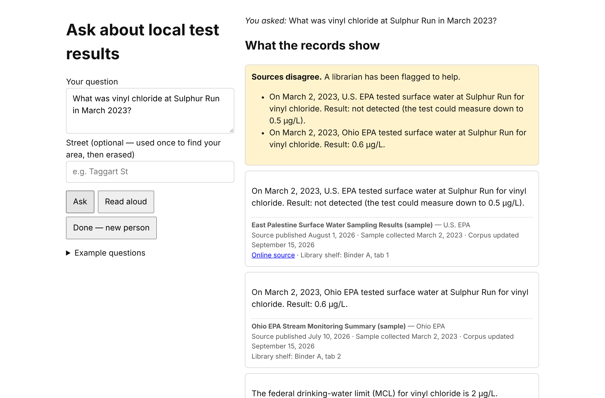

**User-friendly version, phone:**

| Welcome screen (what the kiosk can and can't do) | Topic buttons (no typing needed) |
|---|---|
| 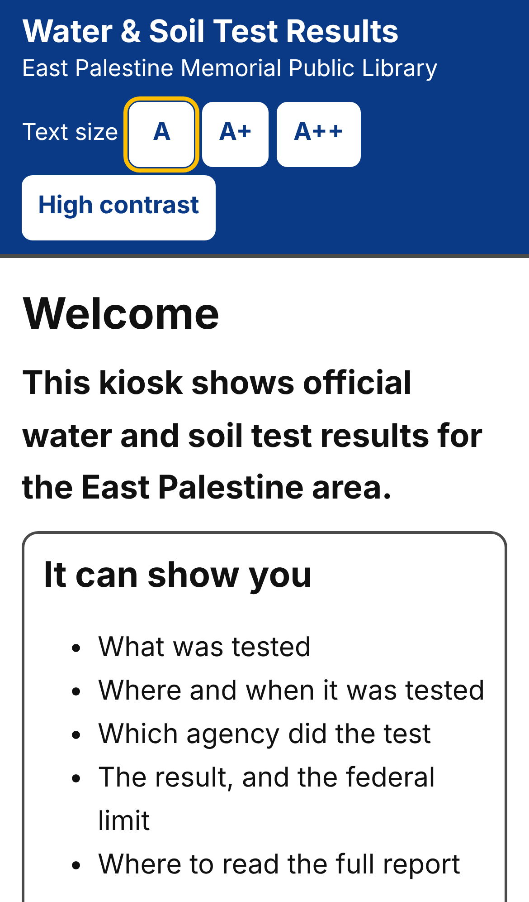 | 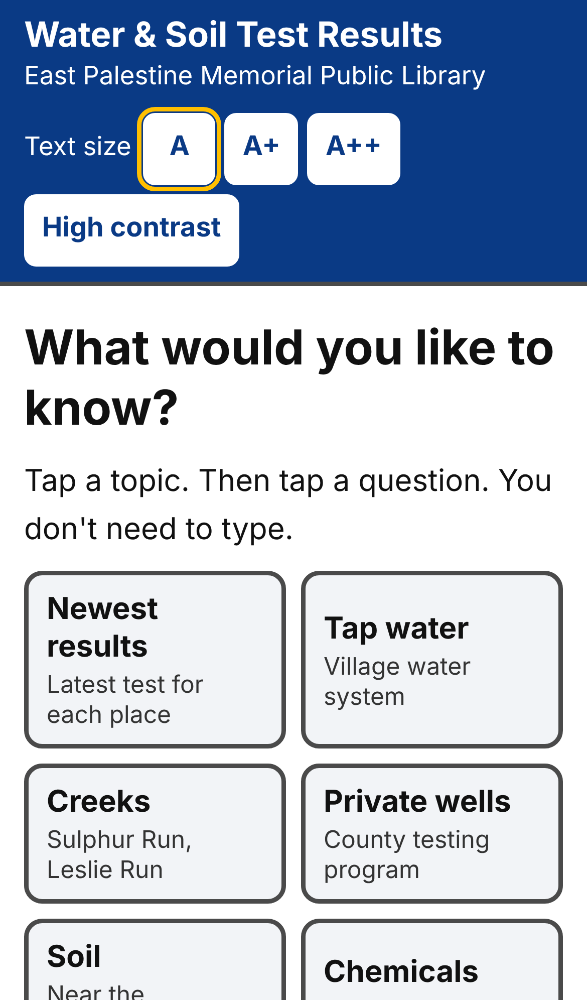 |

| Tap-to-ask questions | "What is vinyl chloride?" → fact card (placeholder until expert-approved) |
|---|---|
| 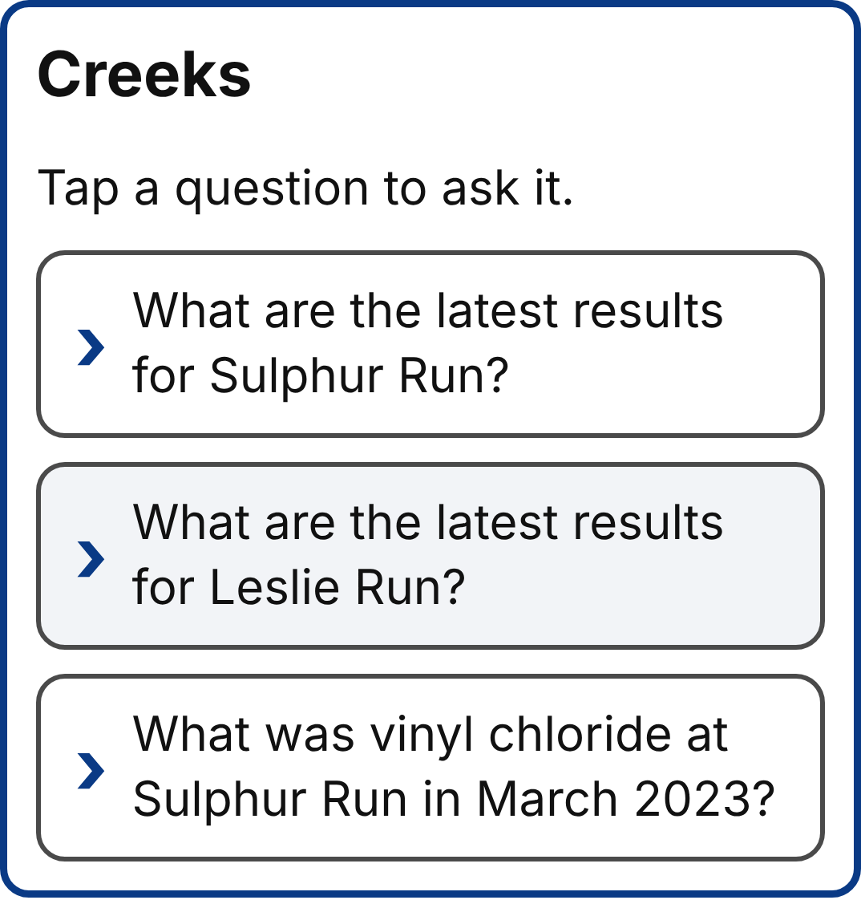 | 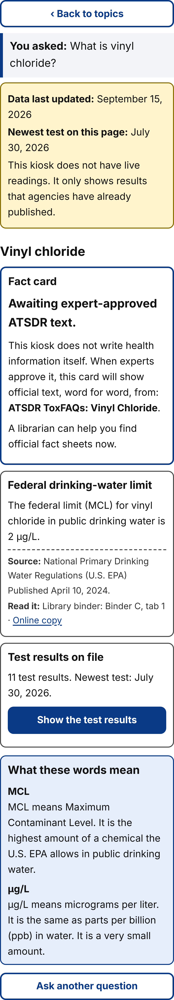 |

| Safety question → refused, with who can help | Nothing matches → "We don't have data on that." |
|---|---|
| 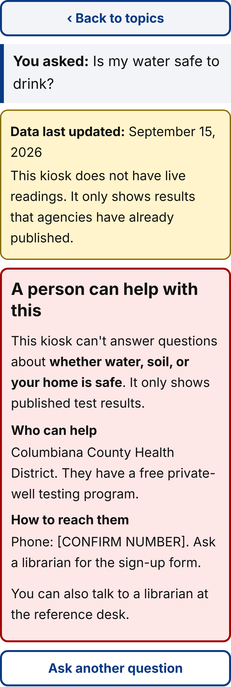 | 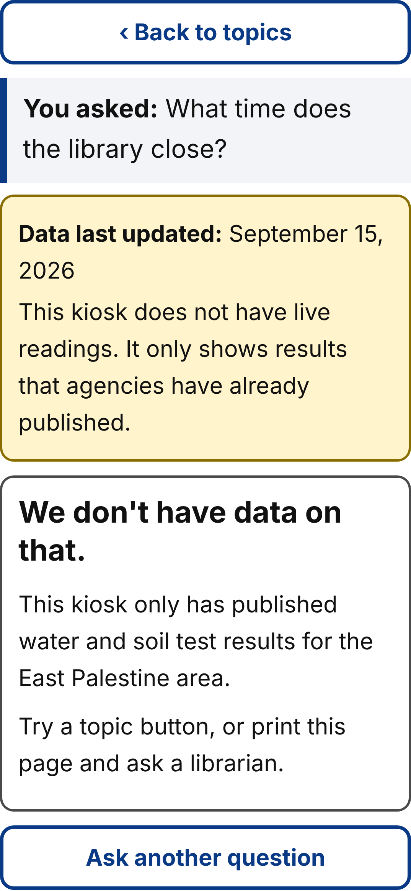 |

**Largest text plus high contrast mode:**
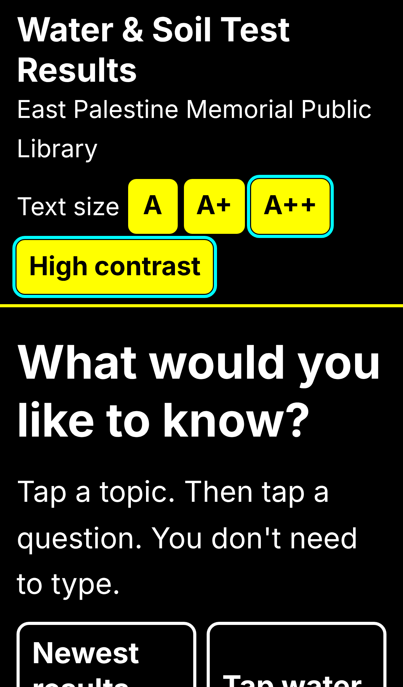

**Desktop: newest result per place shown first, with date banner, citations and words explained:**
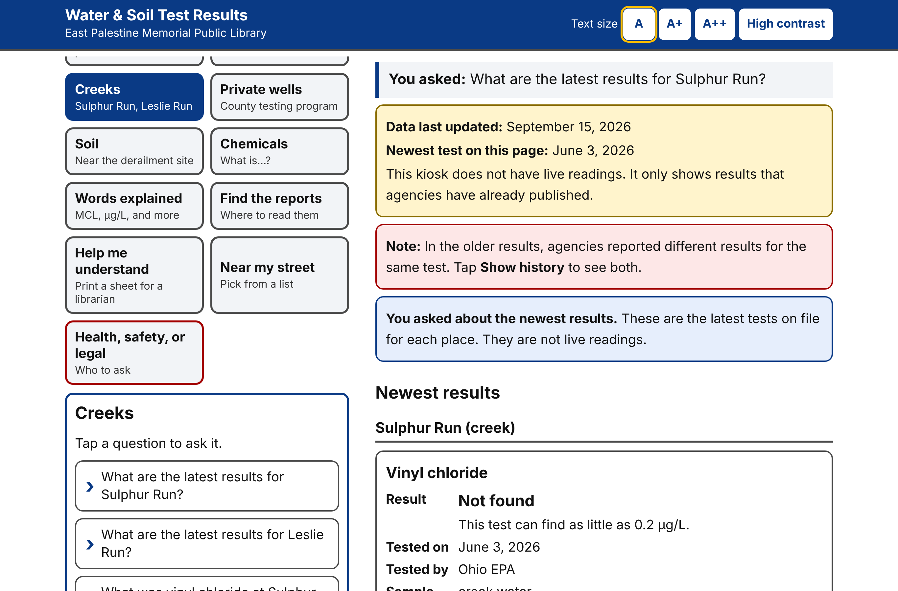

**"Show history" opened. Older results, with an agency disagreement shown and flagged:**
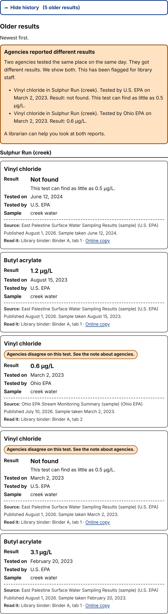

**"Help me understand" question → printable reference sheet for a librarian:**
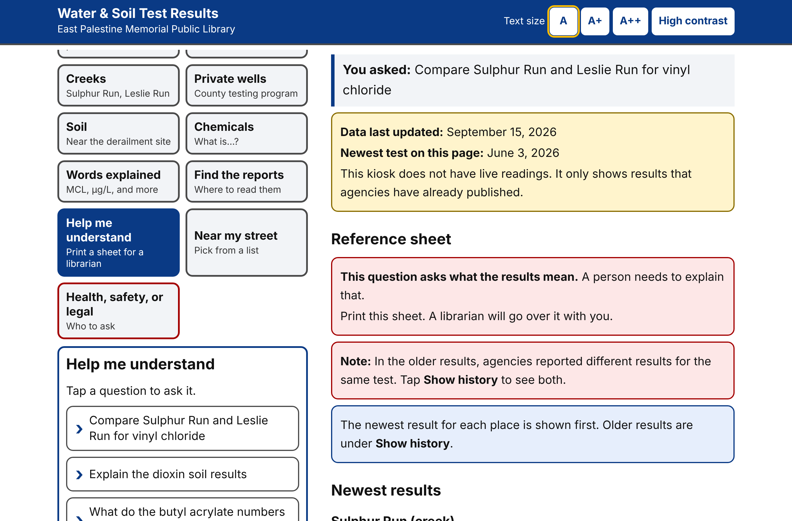

**Report a problem (tap choices, no personal data):**
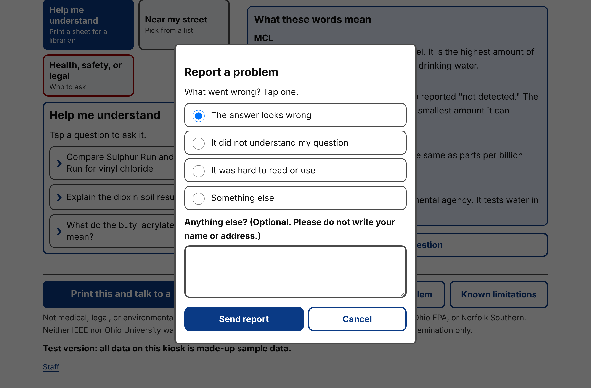

**Staff panel. Kill switch, emergency mode, desk staffed, auto-sunset, usage, reports, release gate (benchmark 100%, red-team refusal 100%):**
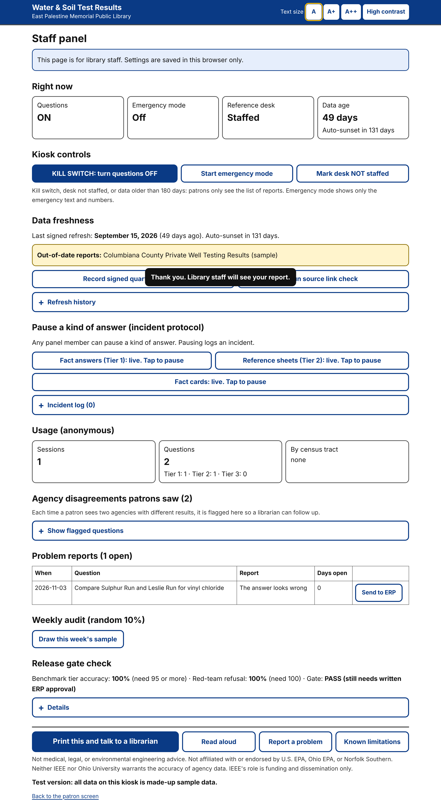

**Kill switch on. Patrons can only browse the list of reports:**
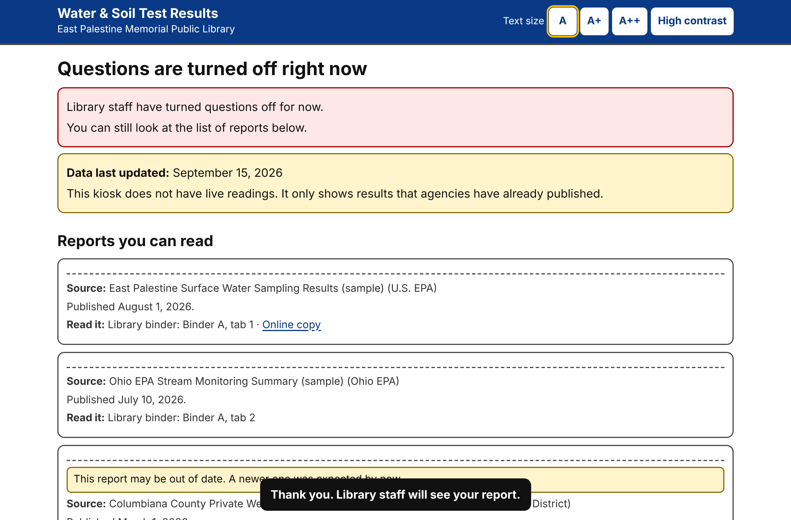

## 5. Plan for next steps (20%)

**Goal:** a resident walks up, asks a question in their own words, and leaves with a correct, sourced answer they understand, or with the right person to call. Every step below is judged by that goal.

**Who we design for:**
- **Residents**, many of them older or with low vision. Some are worried, and some are not comfortable with technology.
- **Librarians** who help at the desk.
- **A non-technical maintainer** who updates the data.

### Phase 1: Learn from real users (weeks 1–3)
- Run 30-minute sessions with **5–8 older residents and 2–3 librarians**. Give them real tasks, such as "find the newest tap water result" or "find out what vinyl chloride is", and ask them to think aloud.
- Record where they hesitate, what words they use, and which questions they try to type.
- Collect **real questions** from the reference desk. These become the benchmark set, so we don't invent test questions.
- **Done when:** we have a ranked list of problems and a vocabulary list of patrons' own words, such as "creek", "city water" and "is it clean".

### Phase 2: Understand questions the way people ask them (weeks 3–6)
The biggest weakness today is that typed questions must match keywords. Residents misspell words, use local names and ask vague or emotional questions.
- Add the Phase 1 words to the alias lists, such as "the run" for Sulphur Run and "town water" for the village system. Also add spelling tolerance.
- **Use an LLM as a question interpreter, not an answer writer.** It maps a free-form question to one of the kiosk's known, tested questions. The kiosk then shows its usual cited answer.
  - For the presentation demo, this can be Claude.
  - For deployment, it will be a local open-weight model. The rule-based safety gate always runs before it.
- **Ask a clarifying question when a question is vague.** For example, "Which water do you mean? Tap water, creek, or private well?" The kiosk shows buttons instead of guessing.
- **Recognize worry, not just keywords.** "Should I be scared?" gets a calm referral card with a person to talk to.
- Add **voice input** using the device's built-in speech recognition, for people who can't type.
- **Done when:** at least 90% of real patron questions reach the right answer or the right referral, and safety refusals stay at 100%.

### Phase 3: Make answers easier to act on (weeks 5–8)
- Test the wording with patrons and keep every answer at a **6th–8th grade reading level**. This is checked automatically.
- Put a one-line "bottom line" first, for example "Newest test: July 30, 2026. Vinyl chloride not found." Details come after.
- Improve the printout: large type, a "questions to ask the librarian" box, and the source binder location.
- **Done when:** at least 80% of test users can explain what the result says, without help, in under 2 minutes.

### Phase 4: Real data and expert-approved content (weeks 6–10)
- Use a Python script to convert the real U.S. EPA, Ohio EPA and county files into the existing record format. Add a signed quarterly refresh.
- The Expert Review Panel approves the fact-card text (verbatim ATSDR), the Known Limitations text and the emergency text, and every contact number is confirmed.
- **Done when:** no sample data and no placeholders remain, and the maintainer can update data by following the README alone.

### Phase 5: Test hard, then deploy (weeks 10–14)
- Grow the evaluation sets to **200 real questions and 75 red-team items**, graded by two people for accuracy, correct citation, no unsupported claims, readability and correct refusal.
- Release gate: benchmark at least 95%, red-team refusal **100%**, and written expert-panel approval.
- Deploy on a locked-down library computer with local storage (SQLite) and a physical kill switch. The staff page must not be reachable by patrons.
- Confirm with Dr. Chang how long anonymous question logs may be kept (ORC 149.432).

### Risks and how we handle them
| Risk | What we'll do |
|---|---|
| The LLM misreads a question or adds claims | It only picks a known question. The safety gate runs first. Answers come from templates with citations. Fall back to the rules if unsure. |
| Patrons feel dismissed by refusals | Each refusal names a person and a phone number, with calm wording that we test with users. |
| Real data is messy (PDF tables, mixed units) | Use a manual review step in the conversion script, and show "We don't have data on that" rather than guess. |
| The kiosk becomes outdated | Stale-data banners, and auto-shutoff after 180 days without a signed refresh. |

## 6. LLMs used and reflection (20%)

**LLM used:** Anthropic **Claude** (model: Claude Opus 5.5), through **Claude Code**, Anthropic's coding agent. It ran in a cloud session linked to the GitHub repository, read the existing code and docs, wrote the code, ran the tests, took the screenshots, committed the work and opened the pull request. The kiosk itself does **not** use an LLM yet. That is a later stage (see step 5 above).

**Reflection:**

*Where it met or beat expectations:*
- **Speed.** It turned a long requirements guide and a short description into a working prototype quickly. It built the safety gate, citations, staff controls, evaluation harness and documentation in one session. Doing this by hand would have taken weeks.
- **It followed the project's rules.** It kept every safety rule, never wrote health text, kept fact cards as placeholders, and kept all data in one swappable file. It also clearly labeled all sample data as made up.
- **It checked its own work.** It wrote an automatic test script (68 checks, all passing, with safety refusals at 100%). It also opened the page in a real browser at phone and desktop sizes to look for errors.
- **It made the safety gate stricter on its own.** It noticed missing phrasings such as "What will it do to me?" and "Is the creek contaminated?", added them, and added matching test questions.
- **It wrote for a non-technical maintainer.** The README and the decisions log use plain language.

*Where it fell short or needed checking:*
- **Problems in the first version.** The first prototype had two real problems: "What is vinyl chloride?" listed test results instead of describing the chemical, and older results were shown first. We only caught these by testing it ourselves. LLM output needs a person to test it.
- **The first way it offered to preview the kiosk didn't work for a non-technical user.** The file card showed raw code. It took a follow-up question to get usable steps.
- **Keyword rules are not real understanding.** The prototype matches keywords, so unusual wording can still be missed. Passing our small test set does not prove it is safe with real patrons. Larger, real test sets and expert review are still needed.
- **It can't replace the people involved.** It can't judge whether older residents will actually find the kiosk easy, and it can't approve health content. User testing and the expert panel are still essential.

*Overall:* it met our expectations for this stage. It produced a safe, working, testable prototype much faster than we could have alone, and its documentation explains the decisions. The main lesson is that the LLM is a fast builder, but we still have to test everything it makes, especially anything about safety.
